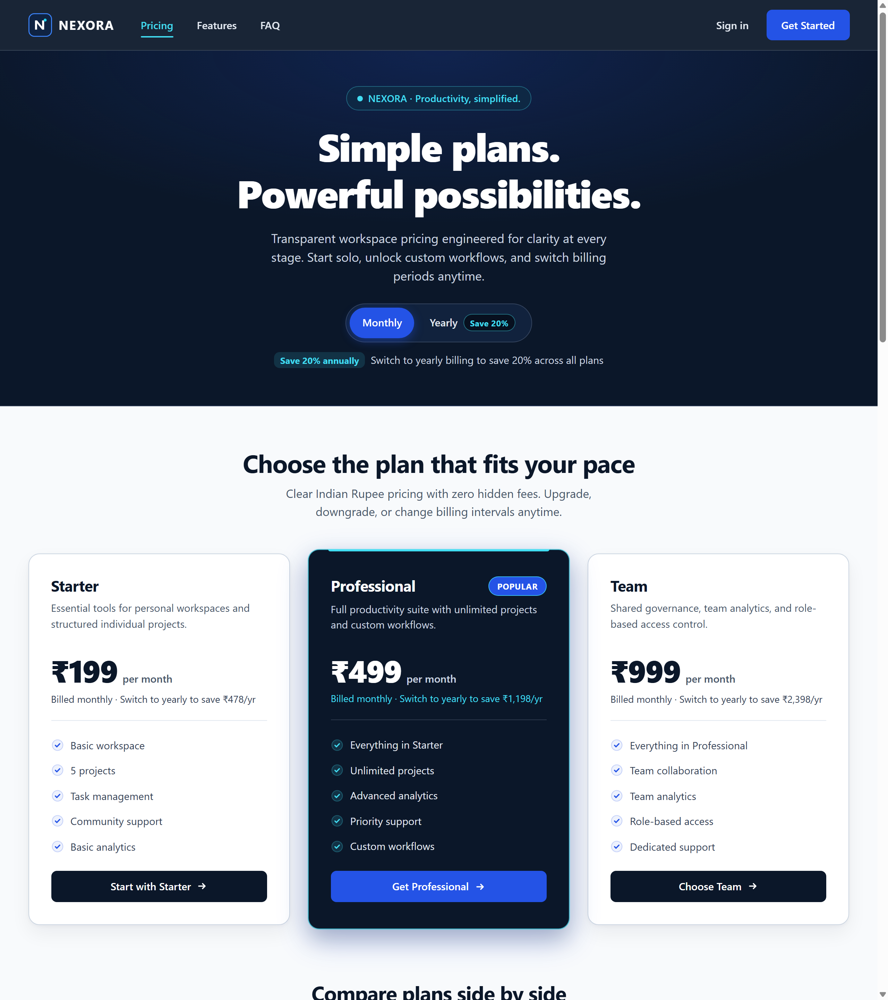
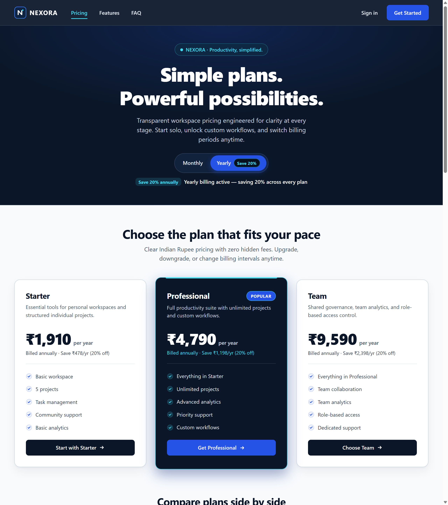

# NEXORA — Responsive SaaS Pricing Page

> **InternCircle Full Stack Web Development — Project 03: Responsive Product Pricing Cards**  
> **Brand:** NEXORA · *Productivity, simplified.*

A polished, responsive, and accessible SaaS pricing platform built exclusively with semantic **HTML5**, modern **CSS3**, and **Vanilla JavaScript**—zero frameworks, zero external dependencies, and zero backend lock-in.

---

## Live Preview Screenshots

### Monthly Billing View


### Yearly Billing View (20% Annual Savings)


---

## Features & Engineering Highlights

- **Interactive Monthly / Yearly Billing Toggle**
  - Uses native `<button>` controls with `aria-pressed` states, subtle compositor-friendly WAAPI number transitions (`opacity` + `translateY`, disabled under `prefers-reduced-motion: reduce`), and live polite screen-reader announcements (`aria-live="polite"`).
  - Price figures, billing intervals (`per month` / `per year`), and savings messages are driven from HTML `data-*` attributes (`data-monthly`, `data-yearly`, etc.) with zero duplicated price constants in JavaScript.
  - Defaults cleanly to **Monthly** billing and highlights the **Save 20%** annual discount across all three plans (`Save ₹478/yr`, `Save ₹1,198/yr`, `Save ₹2,398/yr`).

- **Three Subscription Tiers + Highlighted Popular Plan**
  - **Starter:** `₹199 / month` (`₹1,910 / year`) — Basic workspace, 5 projects, Task management, Community support, Basic analytics.
  - **Professional (Popular):** `₹499 / month` (`₹4,790 / year`) — Highlighted `#0B1729` dark navy card with `#42DDF2` cyan border accent, `#2453E6` electric-blue ambient glow, elevated framing, `Popular` badge, and aligned CTA arrow hover transitions. Includes Everything in Starter, Unlimited projects, Advanced analytics, Priority support, Custom workflows.
  - **Team:** `₹999 / month` (`₹9,590 / year`) — Everything in Professional, Team collaboration, Team analytics, Role-based access, Dedicated support.

- **Responsive Feature Comparison Table (`#comparison`)**
  - Compares all 8 core dimensions side by side: **Number of projects**, **Workspace access**, **Task management**, **Analytics**, **Custom workflows**, **Team collaboration**, **Role-based access**, and **Support availability**.
  - Uses a keyboard-scrollable `<div tabindex="0" role="region" aria-labelledby="comparison-heading" class="table-wrapper">` with `container-type: inline-size`.
  - Automatically adapts via `@container (width < 640px)` into stacked mobile feature cards with injected tier labels (`Starter`, `Professional`, `Team`) via CSS variables.

- **Sticky Scrollspy Navigation & Single-Tree Responsive Menu**
  - Uses CSS `scroll-target-group: auto` and `:is(:target-current, .target-current)` (plus an `IntersectionObserver` fallback and synchronized `aria-current="true"` state) to highlight active sections smoothly as users scroll.
  - Single-tree `<nav>` combines a `ResizeObserver` inline-fit check (`is-wide`) with the native Popover API (`popover="auto"`) for clean mobile menu toggling.
  - Below `800px`, the **Popular (Professional)** tier is prioritized first both visually (`order: -1`) and in DOM focus order (`matchMedia` sync).

- **Trust, Honest Billing Messaging, Team Sales & Conversion CTA**
  - Three concise value propositions backed by an explicit static front-end billing notice (transparently stating that no live payment gateway is connected and no card data is collected or stored).
  - Includes a **Contact Team Sales** inquiry modal (`#sales-dialog`), Plan Preview modals (`#plan-dialog`) for every tier, a simulated Sign-In modal (`#signin-dialog`), and a Final Conversion CTA banner (*"Ready to take control of your productivity?"*).

- **7-Item Accessible FAQ Accordion (`#faq`)**
  - Covers upgrades, cancellations, downgrades, transparent pricing/no hidden charges, payment method status, security transparency, and refund terms alignment.
  - Uses semantic `<h3>` + `<button aria-expanded>` controls and `hidden="until-found"` with `beforematch` support so browser Find-in-Page (`Ctrl+F`) automatically reveals matching answers.

- **Accessibility & Motion Standards**
  - WCAG AA/AAA text contrast verified (`>= 6.08:1` across tested pairs; primary text up to `17.97:1`).
  - Distinct `:focus-visible` outlines (`3px` with offset) tailored for both light and dark navy surfaces, plus `@media (forced-colors: active)` support.
  - Hover elevation (`translateY(-6px)` over `250ms`), CTA arrow shifts, and toggle animations wrapped cleanly in `@media (prefers-reduced-motion: no-preference)` / reduced-motion guards.
  - Minimum `44px` touch target height across interactive elements.

---

## Project Structure

```text
task3/
├── index.html               # Semantic HTML5 document, pricing cards, comparison matrix, 7 FAQs, & <dialog> modals
├── style.css                # Brand tokens (#0B1729, #2453E6, #42DDF2), Grid, container-query table, & animations
├── script.js                # Vanilla JS modules for toggle, sticky/scrollspy nav, DOM sync, FAQ, and dialogs
├── README.md                # Setup, architecture, and QA documentation
└── assets/
    ├── favicon.svg          # Browser tab icon
    ├── nexora-logo.svg      # NEXORA geometric brand mark
    ├── monthly-pricing.png  # Desktop Monthly billing screenshot
    └── yearly-pricing.png   # Desktop Yearly billing screenshot
```

---

## How to Run Locally

1. **Direct Browser Open:**
   Open `task3/index.html` directly in any modern browser (Chrome, Edge, Firefox, or Safari).

2. **VS Code Live Server (Recommended):**
   - Open this repository in VS Code.
   - Right-click `task3/index.html` and choose **Open with Live Server**.

3. **Zero-Dependency Local HTTP Server (Node.js or Python):**
   ```bash
   # Using Python
   cd task3
   python -m http.server 3000
   # Open http://localhost:3000
   ```
   ```bash
   # Or using Node.js npx serve
   npx serve task3 -l 3000
   ```

4. **Test Responsive Breakpoints:**
   Open DevTools (`F12`) and toggle Device Mode (`Ctrl+Shift+M`) at `360px` (mobile), `768px` (tablet), and `1280px` (desktop), plus toggle `prefers-reduced-motion` in the Rendering drawer.
